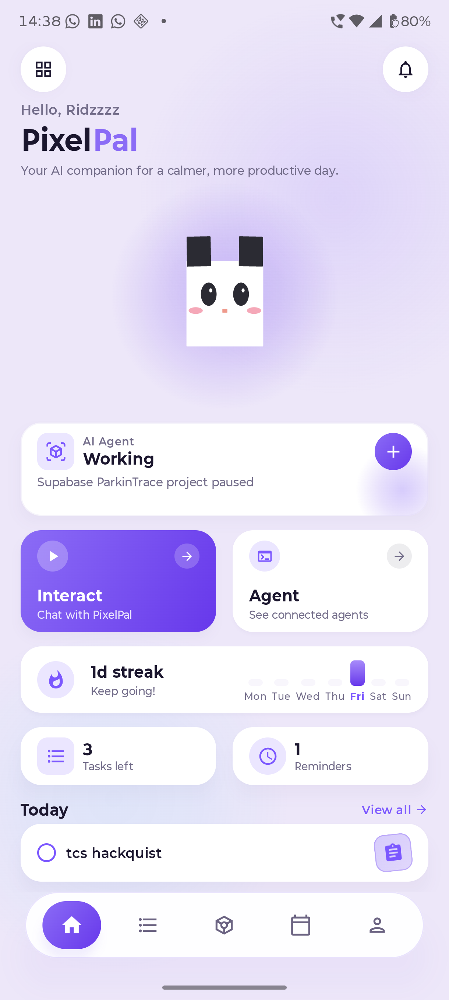
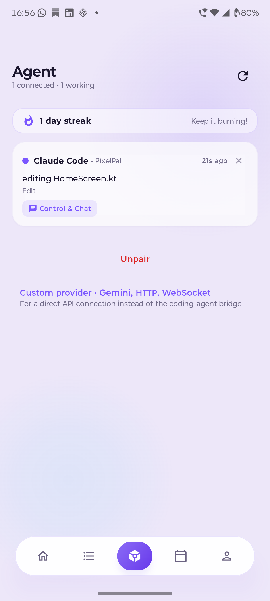

# 🐾 PixelPal

**A pixel-art screen companion that watches your AI coding agents for you.**

<p>
  <a href="https://github.com/riddhibantia/Pixel-Pal-/releases">📲 Download APK</a> •
  <a href="https://riddhibantia.github.io/Pixel-Pal-/mini.html">🟢 Live Widget Demo</a>
</p>

<p>
  
  
</p>

PixelPal is an Android app that lives as a small floating pet on top of your phone screen. Underneath the cute pixel-art exterior, its real job is to be a **live window into your AI agents** — Gemini, custom HTTP-based agents, or anything that streams status over a WebSocket — so you can glance at your pet and instantly know what your agent is doing, without opening a terminal, a laptop, or a dashboard.

Tasks, reminders, a bond/personality system, and character customization round out the companion experience, but the agent-monitoring layer is the core idea: **turn "is my AI agent still working?" into a one-glance question.**

---

## ✨ Why PixelPal

Anyone running long AI coding sessions (Claude Code, OpenCode, Gemini CLI, custom agent runners, CI-style agent jobs, etc.) knows the pattern: kick off a task, then repeatedly tab back in just to check "is it done yet?" PixelPal moves that check off your laptop and onto your phone — your companion reacts, updates, and notifies you as the agent's state changes, so checking in feels like glancing at a pet instead of babysitting a process.

---

## 🧠 Core Feature: Agentic AI Connection

This is what PixelPal is actually built around:

- **Multiple connector types** so PixelPal can talk to almost any agent setup:
  - `GeminiAgentConnector` — direct integration with Google's Generative AI SDK, with token-level streaming (`Flow<String>`) and your companion's personality injected into the prompt.
  - `WebSocketAgentConnector` — a WebSocket client for agents that push live events in real time.
  - `GenericHttpAgentConnector` — polls any agent endpoint that returns a simple JSON contract (`status`, `currentTask`, `progress`, `message`, optional `pendingApproval`), making it possible to hook up custom agents, self-hosted tools, or coding-agent CLIs that expose a status endpoint.
- **Background polling** via `AgentStatusWorker` (15 / 30 / 60 / 120 min, WorkManager's 15-minute floor), so your companion's status stays current even when the app isn't open — network issues surface as OFFLINE, non-2xx responses and malformed JSON surface as ERROR.
- **Companion reacts to agent state**: `CompanionReactionProvider` weaves live agent state into what your pet actually says ("still working on it," task progress, completion), instead of just showing a raw status field.
- **Persisted connection config + status** in a single `AgentConnectionEntity`, so your agent link survives restarts.
- **QR pairing** — point the in-app scanner (CameraX + ML Kit) at a QR code holding the endpoint URL; private-LAN `http://` endpoints (loopback, `10.0.2.2`, `localhost`, RFC1918 ranges) are allowed so a laptop agent on the same Wi-Fi just works. Everything else must be HTTPS.
- **Approval gate** — when the agent sends `pendingApproval`, you get an Approve/Deny notification (`AgentApprovalReceiver`); each approval notifies once, deduplicated by id, and the decision is POSTed back to your agent's command URL.
- **Activity center** surfaces meaningful agent activity (not just taps/feeds) so you get pinged when something actually changes.

The **AI Agent Connection screen** (the "workspace" route) is the hub for all of this: provider chips, endpoint URLs, poll interval, Connect / Save + Check Now, text and voice commands, an optional Gemini API-key override, and QR import.

In short: connect an agent once, and your on-screen pet becomes a live status readout — expressive, glanceable, and always running in the background.

---

## 🐱 The Companion Experience

- **Floating overlay pet** that sits on top of any app, draggable, with idle/blink/sleep animation states rendered via Lottie. (The bubble tucks itself away while PixelPal is in the foreground so you don't get two animations at once.)
- **One active companion** by design — tasks, reminders, agent connection, personality, and bond are all *features of your one pet*, not separate profiles.
- **Tasks & Reminders** — create reminders (one-off, daily, weekly, monthly, with optional snooze) and tasks; completing them feeds directly into your companion's reactions and bond growth rather than just sitting in a plain list. Tasks support subtasks, descriptions, and optional **photo proof** on the detail screen. Reminders arrive as full-screen alarms with Complete / Snooze actions on the notification and in the overlay's dynamic island.
- **Bond & Personality system** — a friendship level (cap 100) that grows through real interaction: completing a task +2, completing a reminder +3, tapping the pet +1 (only the first 3 taps/day count, so it can't be ground). Streaks with milestone celebrations, and a personality that gradually adapts to how you use the app.
- **Character customization** — pick from 7 species (Cat, Dog, Bunny, Panda, Whale, Axolotl, Llama) — every species ships a **full 12-state animated Lottie set** — plus your companion's name and the app theme.
- **Cloud sync** — optional Firebase Auth (email/password, Google sign-in via Credential Manager, or guest/anonymous mode) with two-way Firestore sync of your companion, bond, tasks, reminders, and subtasks, so your pet isn't stuck on one device. Being signed out (or in guest mode on one device only) keeps everything purely local.
- **Offline-first** — Room is the source of truth and the app works with no network. Firestore's persistent cache is capped at **100 MB**, so the app degrades gracefully rather than growing without bound on a full device.
- **Home-screen widgets + desktop mini widget** — Tasks and Home widgets read the same database, and a tiny floating desktop window (`agent-endpoint/mini_pet.py`) mirrors agent status on your laptop.

---

## 🛠️ Tech Stack

- **Language:** Kotlin 2.0, Jetpack Compose, Material 3
- **Architecture:** Clean architecture (presentation → domain → data), single source of truth via `ActiveCompanionManager`
- **DI:** Hilt (including `hilt-work` for workers)
- **Local persistence:** Room **v14** (14 hand-written migrations) + DataStore for preferences
- **Background work:** WorkManager (`AgentStatusWorker`, `BondDecayWorker`, `PersonalityWorker`, `FirestoreSyncWorker`)
- **Networking / streaming:** OkHttp WebSocket, Google Generative AI SDK (Gemini)
- **Cloud:** Firebase Auth + Cloud Firestore
- **Animation:** Lottie Compose (all 7 species × 12 states as raw JSON assets)
- **Build:** Gradle (Kotlin DSL), AGP 8.5.0, Gradle 8.9, KSP for annotation processing (Room + Hilt), R8 minify + resource shrinking in release builds

---

## 🏗️ Architecture Overview

```
presentation/   → Compose UI: home, AI agent connection (workspace), tasks,
                  reminders, activity, settings/profile, onboarding, auth
domain/         → engines & use cases: ActiveCompanionManager, BondEngine,
                  EmotionEngine, AnimationEngine, PersonalityEngine,
                  CompanionEngine, CompanionReactionProvider
data/           → Room DB (companion, bond, personality, tasks, subtasks,
                  reminders, agent connection, activity events), DataStore,
                  Firebase sync, agent connectors (Gemini / WebSocket / Generic HTTP)
overlay/        → floating pet window management (WindowManager overlay,
                  single active overlay session, dynamic island, keyboard dodge)
worker/         → periodic background jobs (agent polling, bond decay,
                  personality recalculation, Firestore sync)
widget/         → home-screen widgets (Home + Tasks)
```

---

## 🚀 Getting Started

### Prerequisites
- Android Studio (latest stable)
- JDK 17
- An Android device/emulator — `minSdk 26`, `targetSdk 35`, package `com.pixelpal.app`

### Setup
```bash
git clone https://github.com/riddhibantia/Pixel-Pal-.git
cd Pixel-Pal-
```

Add your Gemini API key to `local.properties` (this file is not committed):
```properties
GEMINI_API_KEY=your_api_key_here
```

Without a key the app still works — replies fall back to the bundled dialogue packs.

Build and run:
```bash
./gradlew :app:assembleDebug
./gradlew :app:installDebug
```

**Note:** the `:app` module applies the `com.google.gms.google-services` plugin and requires an `app/google-services.json` matching `applicationId` `com.pixelpal.app`. The file in this repo points at a demo Firebase project — **replace it with your own** (Firebase console → Project settings → your Android app) before building against your own account. Cloud sync stays dormant while signed out, so the app is fully usable without Firebase.

### Grant the overlay permission
On first launch, PixelPal will ask for the "Display over other apps" permission — this is required for the floating companion to appear. For keyboard-aware pet positioning you can additionally enable the accessibility service (Settings → Accessibility → PixelPal); the pet works without it.

---

## 📱 Usage

1. **Onboard** your companion — choose a species and name it.
2. **Enable the overlay** so your pet appears on top of other apps.
3. **Connect an agent** from the AI Agent Connection screen — pick Gemini, a WebSocket endpoint, or a generic HTTP status endpoint. The QR scanner can import a URL from your laptop.
4. Go about your day — your companion will animate, speak, and notify you as your agent's status changes.
5. Add **tasks and reminders**; completing them grows your bond level and streak, and gradually shifts your companion's personality.

---

## 🔒 Privacy

- PixelPal keeps your tasks, reminders, companion, and bond **in a local Room database** on the device.
- If you sign in (or use the anonymous guest account), those rows are also written to **your own Firebase account's Firestore database**, under a path keyed by your Firebase uid. Nothing is sent to a server we operate, and other users cannot read your data.
- If you stay signed out on a device, nothing leaves the device.
- Your Gemini API key (from `BuildConfig` or the optional in-app override) is only used to talk to Google's Generative AI API on your behalf.
- The app has no analytics/telemetry SDK and no ad SDK.

---

## 🗺️ Roadmap

- [ ] Additional first-class agent integrations (beyond Gemini/generic HTTP/WebSocket)
- [ ] Richer agent-progress visualizations in the overlay itself
- [ ] More species with full animated sets (all 7 current species already ship 12 animated states each)
- [ ] Wear OS companion view for agent status at a glance
- [ ] Expanded dialogue and reaction library
- [ ] Full localization (UI copy is currently hardcoded English; a string-resource migration is in progress)

---

## ⚠️ Known limitations

These are known, tracked defects rather than surprises. The full, file-and-line-level audit lives in [MEMORY.md](MEMORY.md) (§2 defect list); the short version:

- **Cloud sync edge cases** — a remote row that arrives before a companion is seeded can be dropped from the realtime listeners; reminder/subtask writes are fire-and-forget in places (a failed offline push may not be retried); conflict resolution is last-write-wins on `updatedAt`, so clock skew can mis-order updates. Failed pulls are logged but not currently surfaced in the UI.
- **Gemini polling is billable** — with provider = Gemini and polling enabled, every `AgentStatusWorker` tick is a real `generateContent` call.
- **Personality drift is not yet trustworthy** — `PersonalityWorker` currently feeds itself placeholder stats.
- **Widget quick-actions** — toggling a task from the widget launches a background write without `goAsync`, so a process kill at the wrong moment can drop it; the widget also carries its own copy of the bond rules instead of calling `BondEngine`.
- **Past-due one-shot reminders** skipped while the device was off are left pending until edited rather than firing after boot.
- **Photo proof URIs** are not persisted with `takePersistableUriPermission`, so an attached photo can fail to load after a restart.
- **Overlay/show-hide edge cases** — a fast show→hide can leak a window; the dynamic island's x-position math is fragile.
- **Voice input and QR scanning** depend on system/ML Kit services; the QR alignment frame is currently not drawn (functional, just unaligned).

---

## 🏗️ Building a release APK

Release builds run **R8 minification + resource shrinking**; keep rules for Hilt, Room, kotlinx.serialization, Lottie, WorkManager and the Firestore data classes live in `app/proguard-rules.pro`.

```bash
# Unsigned, minified release APK (same thing CI produces)
./gradlew :app:assembleRelease
# → app/build/outputs/apk/release/app-release-unsigned.apk
```

The build is **unsigned by default** — no keystore is committed to this repository. To sign, supply the four Gradle properties (e.g. in `~/.gradle/gradle.properties` or via `-P`), and the `release` signing config is applied automatically:

```properties
RELEASE_STORE_FILE=/path/to/your-keystore.jks
RELEASE_STORE_PASSWORD=…
RELEASE_KEY_ALIAS=pixelpal
RELEASE_KEY_PASSWORD=…
```

```bash
./gradlew :app:assembleRelease \
  -PRELEASE_STORE_FILE=$HOME/keystores/pixelpal.jks \
  -PRELEASE_STORE_PASSWORD=… -PRELEASE_KEY_ALIAS=pixelpal -PRELEASE_KEY_PASSWORD=…
```

CI (`.github/workflows/`) does the same four properties conditionally from repository secrets — see [RELEASING.md](RELEASING.md) for the full checklist.

---

## 🧪 Tests

```bash
./gradlew :app:testDebugUnitTest          # JVM unit tests (engines, models, logic)
./gradlew :app:connectedDebugAndroidTest  # Room migration/DAO + navigation smoke tests (needs a device)
```

---

## 🤝 Contributing

This is currently a solo/early-stage project. Issues and suggestions are welcome — feel free to open an issue to discuss before submitting a PR.

---

## 📄 License

This project is licensed under the **MIT License** — see [LICENSE](LICENSE).

```
MIT License

Copyright (c) 2026 Riddhi Bantia — PixelPal

Permission is hereby granted, free of charge, to any person obtaining a copy
of this software and associated documentation files (the "Software"), to deal
in the Software without restriction, including without limitation the rights
to use, copy, modify, merge, publish, distribute, sublicense, and/or sell
copies of the Software, and to permit persons to whom the Software is
furnished to do so, subject to the following conditions:

The above copyright notice and this permission notice shall be included in all
copies or substantial portions of the Software.

THE SOFTWARE IS PROVIDED "AS IS", WITHOUT WARRANTY OF ANY KIND, EXPRESS OR
IMPLIED, INCLUDING BUT NOT LIMITED TO THE WARRANTIES OF MERCHANTABILITY,
FITNESS FOR A PARTICULAR PURPOSE AND NONINFRINGEMENT. IN NO EVENT SHALL THE
AUTHORS OR COPYRIGHT HOLDERS BE LIABLE FOR ANY CLAIM, DAMAGES OR OTHER
LIABILITY, WHETHER IN AN ACTION OF CONTRACT, TORT OR OTHERWISE, ARISING FROM,
OUT OF OR IN CONNECTION WITH THE SOFTWARE OR THE USE OR OTHER DEALINGS IN THE
SOFTWARE.
```

---

## 📬 Contact

**Riddhi Bantia**
[email: riddhibantia@gmail.com 
LinkedIn : https://www.linkedin.com/in/riddhi-bantia ]